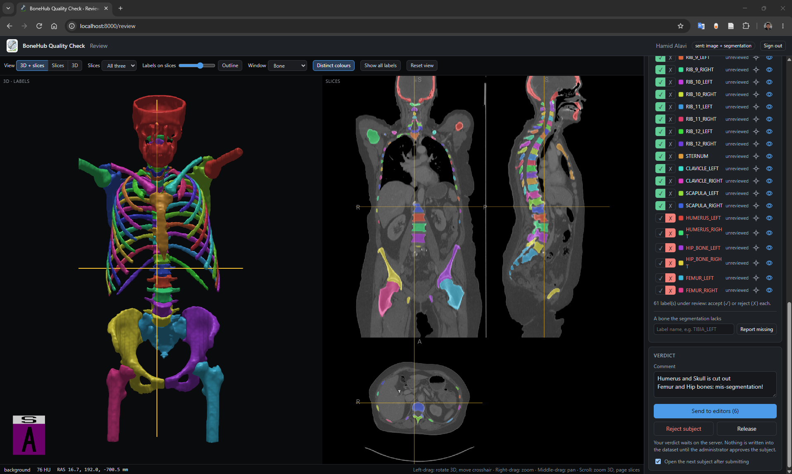

<p align="center">
  
</p>

<p align="center">
  
</p>

# BoneHub Quality Check — Server

This server runs a human quality check of the segmentations in a database in the
[BoneHub format](https://github.com/BoneHub/BoneHub-Format). It hands out scans one at a
time to three kinds of people:

- **Reviewers** look at a segmentation in their web browser and accept or reject each bone
  (each *label*). They can also report bones that are missing.
- **Editors** fix what the reviewers rejected, in 3D Slicer.
- **You, the administrator,** approve the result. **Nothing is written into the database until
  you approve a scan.**

The server runs in Docker, on any computer that can reach the database folder, whether on a
local disk or an SMB share.

A *scan* is one image of a person and its segmentation: `ds-0027/sub-000001/scan-01` is the
first scan of subject 1 of dataset 27, in the BoneHub format's own words. The server names
every scan by that path, and quality-checks each scan of a subject on its own.

## Contents

- [How it works](#how-it-works)
- [Install and start](#install-and-start)
- [First-time setup](#first-time-setup)
- [The admin panel](#the-admin-panel)
- [Everyday tasks](#everyday-tasks)
- [Settings](#settings)
- [Users, roles and keys](#users-roles-and-keys)
- [Labels, stages and what approval writes](#labels-stages-and-what-approval-writes)
- [Running the server](#running-the-server)
- [Where the server keeps things](#where-the-server-keeps-things)
- [Troubleshooting](#troubleshooting)
- [What reviewers and editors see](#what-reviewers-and-editors-see)
- [Reliability study](#reliability-study)
- [For developers](#for-developers)

## How it works

### Who does what

| Who | Works in | Does |
| --- | --- | --- |
| Administrator | the admin panel, `http://<host>:8000/admin` | creates users, follows progress, approves results |
| Reviewer | the review page, `http://<host>:8000/review`, in any modern browser; nothing to install | accepts or rejects each label, reports missing bones |
| Editor | 3D Slicer, with the [BoneHub Quality Check extension](https://github.com/BoneHub/Quality-Check-3DSlicer-Extension) | corrects rejected labels, adds missing bones, segments scans that have no segmentation |

One person can be both a reviewer and an editor. The server never asks anyone to review their
own correction.

### The path of a scan

```
  new scan
      │
      ▼
   REVIEW ◄───────────────────────────────┐  the correction goes back to a reviewer
      │ a reviewer judges each label      │  (unless you switched that off)
      │                                   │
      ├── a label rejected or missing ──► EDIT ── editor cannot fix it ──► ESCALATED
      │                                   │                                (you decide)
      ├── scan rejected ──► REJECTED      │
      │   (you record why)                │
      │ every label accepted              │ correction accepted on the editor's word
      ▼                                   │ (only when corrections need no review)
   APPROVAL ◄─────────────────────────────┘
      │ you approve
      ▼
   APPROVED: written into the database
```

1. **A reviewer judges the scan.** Each label is accepted or rejected. Bones the
   segmentation lacks are reported *missing*.
2. **If anything is rejected or missing, an editor corrects it** in 3D Slicer, deciding for
   each rejected label whether to fix it or take it out, and uploads the corrected segmentation.
3. **A reviewer checks the correction.** The review page shows the editor's version. You can
   switch this step off: see [Should corrections go back to a reviewer?](#should-corrections-go-back-to-a-reviewer)
4. **You approve the scan** in the admin panel. Only then does the server replace the scan's
   segmentation with the correction and update its `scan.json`, and do the labels a reviewer
   accepted count as reviewed. See [What approval writes](#what-approval-writes).

An editor who cannot fix a scan sends it to you with a comment. It then shows as
*escalated*.

A reviewer who finds that **no correction of the segmentation would help** (a poor or cropped
image, or an implant, for example) presses **Reject scan**, with a comment saying why. The
scan goes to you, not to the editors, with its labels as they were, and shows as
*rejected*. You record why in its `scan.json`: see
[Deal with a rejected scan](#everyday-tasks). Rejecting labels is for segmentations that need
a correction.

### Which scans are handed out

- Every scan with at least one label that **no server on this database has reviewed yet**.
  These go to reviewers first. You can narrow this to labels of some
  [origins](#origins-and-reviews) only, such as those a model predicted, or turn it into a
  second review of the labels reviewed already: see [Settings](#settings).
- Scans with an image but no segmentation, only if you turn on **Queue scans without
  segmentation**. These go straight to editors, to segment from scratch.
- Scans already in progress are handed out before new ones.
- An approved scan is never handed out again by the same server, and its reviewed labels
  are not queued by any other server either, unless it runs a second review.

## Install and start

### Requirements

- Docker with Compose v2 (Docker Desktop, or Docker Engine on Linux).
- Read and write access to the database folder: the folder that contains `ds-0001`,
  `ds-0027`, and so on, written with version 1 of the
  [BoneHub format](https://github.com/BoneHub/BoneHub-Format). A dataset folder of BoneHub
  data schema 0.3 (`Dataset_001`, with its `Subject_info_001.json`) must be converted again
  first; this version of the server does not read it.

### Steps

```bash
git clone https://github.com/BoneHub/qc-server.git
cd qc-server
cp .env.example .env                          # then edit .env: say where the database is
docker compose up -d --build
docker compose exec bonehub-qc-server bonehub-qc-server show-admin-key # get the admin key if you have not already set in .env
```

Then open `http://<host>:8000/admin` and sign in with that key. `<host>` is the name or IP
address of the computer running Docker; use `localhost` on that computer itself.

### Tell the server where the database is

In `.env`, fill in **one** of the two options and leave the other blank:

| Database on | Variable | Example |
| --- | --- | --- |
| a disk of this computer | `BONEHUB_DATASET_PATH` | `C:/data/BoneHub_Dataset` |
| an SMB share | `BONEHUB_DATASET_SHARE` | `//192.168.0.10/Data/BoneHub/BoneHub_Dataset` |
| | `BONEHUB_SMB_USERNAME` | `alice` |
| | `BONEHUB_SMB_PASSWORD` | the share password |
| | `BONEHUB_SMB_OPTIONS` | `domain=AD,vers=3.0` |

- If both are filled in, the local folder is used. `docker compose` refuses to start when
  neither is, or when a share is missing its username or password.
- **A mapped network drive (`Z:`) is not a local folder.** Put its UNC path in
  `BONEHUB_DATASET_SHARE`. `net use` shows the UNC path behind each drive letter. Docker
  Desktop cannot mount a drive letter. Given one, it mounts an empty folder instead, and the
  server starts with `0 of 0 scans`.
- A share password cannot contain a comma. Write a `$` in it as `$$`.
- **After changing the share or any `BONEHUB_SMB_…` value**, recreate the share's volume.
  This loses nothing, because the volume only holds the connection to the share. For a
  server with an [env file of its own](#another-server-on-this-computer), write its name
  instead of `bonehub_qc` and add its `--env-file` to both `docker compose` commands:

  ```bash
  docker compose down && docker volume rm bonehub_qc_dataset && docker compose up -d
  ```

### Update the server

```bash
git pull && docker compose up -d --build
```

The server keeps its admin key, its users and all work in progress.

**Update the 3D Slicer extension at the same time.** The extension refuses to connect to a
server of another major version. If a new server version refuses to start on the
state an older one left behind, start a
[new server](#where-the-server-keeps-things).

**The server's major version is the BoneHub format's.** Server 1.x reads databases in version
1.x of the format, and refuses to start with a `bonehub_format` of another major version. A new
major version of the format comes with a new major version of the server.

**Coming from server 0.4, written for BoneHub data schema 0.3:** server 1.0 reads only
databases in the BoneHub format, version 1. Finish or close the quality check in progress with
0.4 first: its verdicts name subjects of the old layout. Then convert the dataset to the new
format, point `.env` at the new database, and replace these settings, which 1.0 refuses to
start with:

| Old setting in `.env` | Now |
| --- | --- |
| `BONEHUB_QC_ELIGIBLE_LABEL_VALUES=1` | blank, or `BONEHUB_QC_ELIGIBLE_REVIEW_STATES=not_reviewed` |
| `BONEHUB_QC_ELIGIBLE_LABEL_VALUES=2` | `BONEHUB_QC_ELIGIBLE_REVIEW_STATES=reviewed` |
| `BONEHUB_QC_ELIGIBLE_LABEL_VALUES=1,2` | `BONEHUB_QC_ELIGIBLE_REVIEW_STATES=not_reviewed,reviewed` |
| `BONEHUB_QC_INCLUDE_SUBJECTS_WITHOUT_SEGMENTATION` | `BONEHUB_QC_INCLUDE_SCANS_WITHOUT_SEGMENTATION` |
| `BONEHUB_QC_MARK_REMOVED_LABELS_ABSENT` | gone: a label no longer in an approved segmentation is always taken out of `scan.json` |

A server that finds its folder in the database holds a quality check of the old layout refuses
to start, and says so.

## First-time setup

1. **Sign in.** Open `http://<host>:8000/admin` and enter the admin key printed at the first
   start. Lost it? See [The admin key](#the-admin-key).
2. **Check the database is found.** The **Queue** section shows *Scans total* and
   *Eligible*. If both are 0, the database is not mounted: see
   [Troubleshooting](#troubleshooting).
3. **Check the policy.** The defaults suit a first quality check. The
   [Settings](#settings) section explains each one. Settings in `.env` win over the panel at
   every start.
4. **Create users** under **Create user**, or [in the env file](#users-from-the-env-file). Pick
   their roles and what they are sent. Then:
   - send a reviewer their **invite link**, which opens the review page already signed in;
   - send an editor their **key** and the server's address, `http://<host>:8000`.
5. **Editors install the extension.** Its
   [README](https://github.com/BoneHub/Quality-Check-3DSlicer-Extension)
   explains how.
6. **If users connect from outside a trusted network, put HTTPS in front of the server.** Keys
   and images travel with every request.

## The admin panel

Open `http://<host>:8000/admin`. The panel keeps your key until you close the browser tab.

**Top buttons:**

- **Refresh** reloads every section.
- **Re-scan dataset** reads the database folder again right away. Otherwise the server does
  this every 5 minutes, so new scans or changed `scan.json` files show up within 5 minutes.
- **Sign out** forgets the key in this tab.

### Queue

A count of scans at each point of the quality check:

| Box | Counts scans that… |
| --- | --- |
| Awaiting approval | have every label accepted and wait for you. Highlighted when above 0 |
| Escalated | an editor could not fix and sent to you. Highlighted when above 0 |
| Rejected scans | a reviewer rejected as a whole, for you to record why. Highlighted when above 0 |
| To review | are in progress and wait for a reviewer |
| To edit | are in progress and wait for an editor |
| Out now | someone is working on right now |
| Not started | are eligible and nobody has looked at yet |
| Approved | you approved; they are written into the database |
| Closed | you closed without writing their labels or segmentation |
| On other servers | another server that uses this database has out or in progress |
| Eligible | match the queue policy |
| Scans total | are in the database |

A scan someone is working on counts under *Out now*, not under its stage. Below the boxes,
the panel shows when the database was last read and how many eligible scans each dataset has.

### Approvals

This is where you decide. The **Showing** menu picks what to list:

| Showing | Lists scans that… |
| --- | --- |
| waiting for approval (default) | are ready for you to approve |
| escalated by an editor | an editor could not correct, and sent to you |
| rejected scans | a reviewer rejected as a whole |
| waiting for a reviewer | are in progress, at a reviewer |
| waiting for an editor | are in progress, at an editor |
| approved | are finished and written into the database |
| closed | you closed |
| all | are in any of the above |

**Comments containing** narrows the list to scans with a comment that contains what you
type, for example `hip implant`. It searches every comment in the scan's history, by
reviewers, editors and you, and ignores upper and lower case. The list then shows the
matching comments, with the words found marked, so you can spot one that only looks like a
match, such as "no implant".

Each row shows:

- **Stage**: where the scan is.
- **Labels**: a summary such as "3 accepted · 1 to review". Click it to see every label: its
  state and who stands behind it, for example "accepted by rita, corrected by eddie". For a
  scan waiting for approval, the line below says what approving will write, for example
  "On approval: 3 reviewed; FEMUR_RIGHT recorded as manual".
- **Segmentation**: "the scan's own" or "correction by eddie". **Download** saves it as a
  `.seg.nrrd` file, to open in 3D Slicer.
- **Latest**: the last step, who took it, and their comment, with the remark it added to
  `scan.json` when that is not its comment. While you filter by comment, this column shows
  the matching comments instead.

Tick the scans to act on (the box in the header row ticks every scan listed), then press
one of the buttons above the list:

| Button | What it does to the ticked scans |
| --- | --- |
| **Approve…** | Writes them into the database |
| **Close…** | Ends their quality check without writing their labels or segmentations. They are not handed out again unless you send them to the reviewers or the editors, which reopens them. One closed already stays as it is |
| **To reviewers…** | Sends them back to the reviewers: every verdict is reviewed again. You can add a comment for the reviewers |
| **To editors…** | Sends them to an editor, with a comment saying what to fix if you like |

Each button opens a dialog that says what will happen and asks for an optional remark to add to
the scans' `scan.json` (see [Remarks](#remarks)). For **Close…**, when every ticked
scan is a rejected one and their reviewers gave the same reason, the remark starts from that
reason. Afterwards the panel lists any scan it could not act on, with the reason.

The buttons act only on what you ticked, never more, and only on scans the filters keep:
while the list reloads after you change a filter, they wait. Each scan is acted on only as it
was listed: one that changed since, because somebody gave a verdict on it or took it, is left
out and reported. Refresh and look again.

You can also approve a scan that does **not** wait for approval: one a reviewer rejected, one
an editor escalated, one waiting for a reviewer, or one you closed. The dialog says so first.
Approving it makes only the labels a reviewer accepted reviewed. The labels nobody accepted
stay as they were: not reviewed, so they enter the queue of the next server on the database, or
reviewed, if they were already and nobody redrew them. An editor's correction waiting on the
server is written into the database all the same.

While someone is working on a scan, it has no tick box, and "with *name*" shows under its
stage. To act on it anyway, release it first under **Assignments**. An approved scan cannot
be ticked: it is finished.

### Create user and Users

**Create user** makes a new account: a name, its roles, which datasets it may see (blank means
all), what it is sent of each scan, and an optional note. **Create & issue key** shows the
key, together with an invite link for a reviewer. See
[Users, roles and keys](#users-roles-and-keys).

The **Users** table lists every account:

| Column | Shows |
| --- | --- |
| Key | the first characters of the key, to tell keys apart |
| Status | active or disabled |
| Roles | reviewer, editor, or both. Change them here at any time |
| Open | scans they hold right now |
| Reviewed / Edited | how many scans they reviewed and corrected |
| Sent | what they are sent of each scan. Change it here at any time |
| Datasets | the datasets they may see |

The buttons:

- **Show key** shows the user's key again, with their invite link.
- **New key** issues a new key. The old one stops working immediately.
- **Disable** blocks the account until you press **Enable**.
- **Delete** removes the account. Any scans the user holds go back to the queue.

### Assignments

One row each time a scan was handed to someone:

| State | Meaning |
| --- | --- |
| assigned | the user has it right now |
| submitted | the user sent a verdict or a correction. The *Verdict* column says what it did and where the scan went |
| released | the user or you handed it back unfinished |
| expired | the lease ran out and the scan went back to the queue |

**Release** on an assigned row returns the scan to the queue now, for example when someone
is away. The **State** menu filters the list.

### Recent activity

The last 50 events: verdicts, corrections, approvals, scans handed out, and changes to
users. Comments appear here too.

### Policy

The server's settings. Change them and press **Save policy**. They take effect at once, and the
database is re-scanned. See [Settings](#settings) for what each one does. A setting filled in
in `.env` comes back at the next restart.

## Everyday tasks

**Approve finished scans.** Under **Approvals**, show *waiting for approval*. Open the
**Labels** summary to see who accepted what. If you want to look yourself, **Download** the
segmentation and open it in 3D Slicer. Then tick the scans (the box in the header ticks them
all) and press **Approve…**.

**Record a finding, such as an implant, in `scan.json`.** Ask the reviewers to judge each
bone as usual, and to write the finding in their comment, always in the same words, for
example "hip implant". They reject the scan only when the finding means no correction would
help (see below); otherwise its bones are still worth reviewing. Then, before you approve anything else:

1. Under **Approvals**, show *waiting for approval* and type `hip implant` in **Comments
   containing**.
2. Read the matching comments, and tick the scans they really describe.
3. Press **Approve…** and type the remark, for example `Hip implant`. Each ticked scan's
   `remarks` in `scan.json` gets `QC: Hip implant` (see [Remarks](#remarks)).

Approve these scans first. **Approve…** without a remark writes none, and an approved scan
cannot be given one afterwards, except by editing its `scan.json` by hand. Show *all* to find
scans with the finding at other stages, for example one a reviewer rejected for it before
you gave these instructions.

**Deal with a rejected scan.** Show *rejected scans* and read the reviewer's reason
under **Latest**. Tick the scan, then press:

- **Close…**, whose remark starts from the reviewer's comment. Edit it into the words you use
  for that finding, for example `Hip implant`, and it is added to the scan's `remarks` in
  `scan.json` as `QC: Hip implant` (see [Remarks](#remarks)). Nothing else is written: the
  labels and the segmentation stay as they are, and none becomes reviewed. Scans rejected for
  the same reason can be closed together;
- **To reviewers…**, if you disagree with the reviewer: every label is judged again.

**Deal with an escalated scan.** Show *escalated by an editor* and read the editor's
comment under **Latest**. Tick the scan, then press:

- **To editors…**, with a comment saying what to do, if it can be fixed after all;
- **To reviewers…**, if the verdicts should be looked at again;
- **Close…**, if the scan cannot be used, with a remark for its `scan.json` if you like.
  Nothing else is written into the database.

**Send back a scan that does not look right.** Before approving, tick it and press **To
reviewers…** (to have every label judged again) or **To editors…** (with a comment saying what
to fix).

**Free a scan someone is holding.** A scan returns to the queue by itself when the lease
runs out, 24 hours by default. To free it sooner, press **Release** under **Assignments**.
Users can extend their own lease, from the review page or from 3D Slicer.

**Send a key again.** Press **Show key** for that user.

**Replace a leaked key.** Press **New key** for that user and send them the new key or invite
link.

**Remove someone.** **Disable** blocks them for now. **Delete** removes them, and their open
scans go back to the queue.

**Review scans that were reviewed before: a second review.** Start a second server on the
database (see [Another server on this computer](#another-server-on-this-computer)) and set its
**Labels to review** to *reviewed already* under **Policy**, or `ELIGIBLE_REVIEW_STATES=reviewed`
in its env file. It hands out the scans whose labels another server has reviewed, and only those
labels are under review. *both* reviews the rest as well. A server never hands out a scan it
has approved itself again, so a second review needs a server of its own.

**Review only what a model segmented.** Set **Of origin** to `model` under **Policy** -- or to
one model, `model:TotalSegmentator` -- and only labels of that [origin](#origins-and-reviews)
are under review. The others are *kept*, as they are, and do not become reviewed.

**Have editors segment scans that have no segmentation.** Turn on **Queue scans without
segmentation**. These scans go to editors only. An editor who is sent the image only can
segment them too.

**Check what happened to a scan.** Under **Approvals**, show *all* and open its **Labels**.
**Recent activity** and the [log files](#logs-and-audit-trail) have the full history.

## Settings

### Where settings come from

You can change a setting in two places:

- **The Policy section of the admin panel.** The change applies at once and is saved in the
  server's `config.json`.
- **`.env`**, as `BONEHUB_QC_<NAME>`. A value filled in there **wins over the panel at every
  start**, so a change you make in the panel is undone by the next restart or update. Leave a
  setting blank in `.env` to manage it from the panel. `.env.example` leaves every setting
  blank.

`docker-compose.yml` passes every setting of the panel's Policy section to the server, and
`BONEHUB_QC_ALLOWED_DATASET_IDS` and the keys. It does not pass `INDEX_REFRESH_SECONDS` or
`MAX_UPLOAD_BYTES`: to set one of them from `.env`, also add it to the `environment:` block of
`docker-compose.yml`, the same way as the others.

### All settings

| In the panel | In `.env` (`BONEHUB_QC_…`) | Default | What it does |
| --- | --- | --- | --- |
| Labels to review | `ELIGIBLE_REVIEW_STATES` | `not_reviewed` | Which labels put a scan in the queue, and are under review: `not_reviewed`, those no server on this database has reviewed; `reviewed`, those one has (a second review); or both, `not_reviewed,reviewed`. See [Origins and reviews](#origins-and-reviews) |
| Of origin | `ELIGIBLE_ORIGINS` | any | Only labels of these [origins](#origins-and-reviews) in `scan.json`, comma-separated: `source`, `manual`, `model`, `derived`, or a model by name, such as `model:TotalSegmentator` |
| Lease TTL (seconds) | `LEASE_TTL_SECONDS` | `86400` (24 h) | How long a user keeps a scan before it returns to the queue. At least 60 |
| Assignment strategy | `ASSIGNMENT_STRATEGY` | `sequential` | `sequential` hands out the lowest scan number first; `random` picks one at random |
| Editors' corrections go back to a reviewer | `EDITS_NEED_REVIEW` | on | See [below](#should-corrections-go-back-to-a-reviewer) |
| Queue scans without segmentation | `INCLUDE_SCANS_WITHOUT_SEGMENTATION` | off | Also hand out scans that have an image but no segmentation, to editors, to segment from scratch |
| Require geometry match | `REQUIRE_GEOMETRY_MATCH` | on | Refuse a segmentation whose voxel grid differs from its image |
| Keep segmentation backups | `KEEP_SEGMENTATION_BACKUPS` | on | Copy the scan's segmentation into `backups/` before an approval replaces it |
| — | `ALLOWED_DATASET_IDS` | all | Use only these datasets, by their BoneHub IDs, for example `27,180` for `ds-0027` and `ds-0180`. Blanking it later does **not** undo it: set it to `none` |
| — | `INDEX_REFRESH_SECONDS` | `300` | How often the database folder is read again. `0` reads it on every request. Each time, the server reads every scan's `scan.json` |
| — | `MAX_UPLOAD_BYTES` | `536870912` (512 MB) | Largest correction an editor can upload |

Other variables in `.env`:

| Variable | What it does |
| --- | --- |
| `BONEHUB_QC_PORT` | The port the server is reached on. Default `8000` |
| `BONEHUB_QC_ADMIN_KEY` | Choose the admin key yourself. Blank: the server makes one at its first start |
| `BONEHUB_QC_PRIVATE_KEY` | The secret behind every user key. Blank: the server makes one. **Changing it makes every issued key stop working** |
| `BONEHUB_QC_USERS` | Users and their keys, as `alice:key1,bob:key2`. See [Users from the env file](#users-from-the-env-file) |

Most changes apply from each user's next request. A new lease time applies to scans handed
out after the change. `bonehub-qc-server show-config` prints the settings in use.

### Should corrections go back to a reviewer?

This is the **Editors' corrections go back to a reviewer** setting.

**On (default, safest).** Every label an editor changed, added or fixed goes back to a
reviewer before you can approve it.

**Off (faster).** 3D Slicer shows a tick box next to each label, ticked by default. An
editor's correction goes straight to approval, unless the editor unticks a label:

- a label the editor changed, or one nobody has reviewed yet (for example in a scan a
  reviewer rejected and you sent to the editors), is accepted on the editor's word when
  left **ticked**;
- such a label left **unticked** still goes to a reviewer;
- a label the editor removed is removed without a reviewer, and a missing bone the editor did
  not add stays out;
- a label a reviewer has already accepted keeps that verdict.

> **Editors must reconnect after you change this setting.** 3D Slicer reads it only when the
> editor presses **Connect**. Until they disconnect and connect again, Slicer works with the old
> value. When you switch the setting off, Slicer shows no tick boxes and every correction still
> goes to a reviewer. When you switch it on, their ticks are ignored, so again every correction
> goes to a reviewer.

## Users, roles and keys

### Roles

| Role | Works in | Is handed | Can |
| --- | --- | --- | --- |
| Reviewer | the review page | scans waiting for a review | accept or reject each label, report missing bones, reject the whole scan, hand the scan back |
| Editor | 3D Slicer | scans a reviewer sent back, and scans with no segmentation | upload a corrected segmentation, send the scan to you, hand the scan back |

- New users get both roles unless you untick one. Every user needs at least one.
- A user holds one scan at a time in each role, until they submit it or hand it back.
  Asking for the next scan before that gives them the same one again. A user with both
  roles can hold one scan as a reviewer and one as an editor.
- The server checks the role on every request. A reviewer who connects from 3D Slicer is told
  to use the review page. An editor-only user cannot sign in to the review page.
- Role changes apply from the user's next request.

### What a user is sent

Set under **Sent to the user** when you create them, and changeable in the **Users** table:

| Setting | Sent | Good for |
| --- | --- | --- |
| Image + segmentation (default) | both | most users |
| Segmentation only | the segmentation | reviewers who judge the shape of the bones without the image. They are not handed scans without a segmentation |
| Image only | the image | editors who segment from scratch. As reviewers, they can only report missing bones or reject the scan, not judge a label they have not seen |

A file a user is not sent cannot be downloaded by them either.

### Datasets a user may see

Leave **Dataset ids** blank for all datasets, or list some by their BoneHub IDs, for example
`27,180` for `ds-0027` and `ds-0180`. The user is then handed scans of those datasets only.

### Keys

- **Show key** shows a user's key again at any time. The keys are kept inside the container,
  with the admin key. A key issued before the server kept keys cannot be shown: press
  **New key** once for that user.
- **Reviewers** get an **invite link**, `http://<host>:8000/review#key=bhqc_...`, which signs them
  in to the review page. The key after `#` never reaches the server's logs. The link still *is*
  the key, so send it privately.
- **Editors** get the key and the server address, which they enter in the 3D Slicer extension.
- **Copy key** and **Copy invite link** work only over HTTPS or on `localhost`. Otherwise, select
  the text and copy it by hand.

### Users from the env file

To start a server with its users already there, list them with keys you choose in
`BONEHUB_QC_USERS`, as `name:key` pairs separated by commas:

```bash
BONEHUB_QC_USERS=alice:bhqc_4f9a...,bob:bhqc_77c2...
```

A key can be any text without commas or colons. `echo bhqc_$(openssl rand -hex 24)` makes a
good one. At every start, the server creates each user it does not have yet, and gives each
user the key set here. **New key** in the panel therefore lasts only until the next start.

Only the name and the key come from the env file. A new user starts as reviewer and editor,
sent the image and the segmentation, for all datasets. Change that in the panel; the server
keeps it. A user you delete in the panel comes back at the next start, unless you remove them
here too.

### From the command line

Everything under **Users** can also be done inside the running container:

```bash
docker compose exec bonehub-qc-server bonehub-qc-server add-user --name alice
docker compose exec bonehub-qc-server bonehub-qc-server add-user --name bob --roles reviewer --datasets 1,2
docker compose exec bonehub-qc-server bonehub-qc-server add-user --name carol --roles editor
docker compose exec bonehub-qc-server bonehub-qc-server add-user --name dave --roles reviewer --data-access segmentation
docker compose exec bonehub-qc-server bonehub-qc-server list-users
docker compose exec bonehub-qc-server bonehub-qc-server rotate-key --name alice
```

`--roles` takes `reviewer`, `editor` or `reviewer,editor` (the default). `--data-access` takes
`image_and_segmentation` (the default), `segmentation` or `image`. The running server sees the
change at once.

## Labels, stages and what approval writes

### Stages

| Stage (as the panel shows it) | Meaning | Handed to |
| --- | --- | --- |
| to review | waits for a reviewer | reviewers |
| to edit | a reviewer rejected a label or reported one missing, or you sent it to the editors | editors |
| awaiting approval | every label is accepted, or not under review | nobody: waits for you |
| escalated | an editor could not fix it | nobody: waits for you |
| rejected | a reviewer rejected the scan as a whole: no correction would help | nobody: waits for you |
| approved | written into the database | nobody on this server, ever again |
| closed | you ended it without writing its labels or segmentation, only a remark if you gave one | nobody, unless you send it back |

### Label states

| State (as the panel shows it) | Meaning |
| --- | --- |
| to review | waits for a reviewer: the server queues it (see below), or an editor changed it |
| accepted | a reviewer accepted it, or the editor vouched for it when corrections need no review |
| rejected | a reviewer rejected it, for an editor to correct or take out, or reported it missing |
| removed | no longer in the segmentation. Taken out of `scan.json` on approval |
| kept | not under review: reviewed already, or of an origin the server does not queue. Left as it is |

### Origins and reviews

The BoneHub format records where each label of a scan comes from, its **origin**, in the scan's
`scan.json`:

```json
"segmentation": {"SACRUM": "source", "HIP_BONE_LEFT": "model:TotalSegmentator@2.4.0", "FEMUR_LEFT": "manual"}
```

| Origin | Means |
| --- | --- |
| `source` | it came with the source dataset |
| `manual` | drawn by hand for this dataset |
| `model:<name>@<version>` | predicted by a model |
| `derived:<tool>@<version>` | computed from another file of the same scan |

The format does **not** record whether anybody reviewed a label. The quality-check servers keep
that themselves, in their folders in the database (see
[Where the server keeps things](#where-the-server-keeps-things)): each approval records which
labels it left reviewed, and the segmentation it left. A label is **reviewed** when the latest
approval of its scan, on any server on this database, left it reviewed, and the scan's
segmentation is still the file that approval left. So:

- a label is reviewed for every server on the database, whichever server approved it;
- converting the dataset again, or any other tool rewriting a scan's segmentation, makes every
  label of that scan not reviewed again: the voxels may have changed;
- moving or copying the database keeps the reviews, as long as `.bonehub_qc` moves with it.

A label of the segmentation is **under review** when its origin is one of *Of origin* (any, by
default) and its review state one of *Labels to review* (not reviewed yet, by default). A label
the segmentation paints but `scan.json` does not list is under review whatever these say:
nobody can tell where it comes from. Every other label is *kept*.

### What an editor's correction does to each label

The server compares the correction with the segmentation it replaces, voxel by voxel:

- **Labels the editor changed or added, and labels a reviewer rejected,** go back to a reviewer,
  or are accepted when [corrections need no review](#should-corrections-go-back-to-a-reviewer)
  and the editor ticked them.
- **Labels the editor did not touch** keep their verdict. If a correction spills into an
  accepted neighbouring bone, that neighbour loses its acceptance and is reviewed again. One
  that nobody has reviewed yet is accepted when corrections need no review and the editor
  ticked it.
- **Labels the editor deleted** are removed. When corrections need review, a reviewer must
  agree first: they agree by accepting the removal, and undo it by reporting the bone missing.
- **A bone reported missing that the editor did not add** goes back to a reviewer, when
  corrections need review, so the reviewer sees the editor disagreed.

### What approval writes

Approving a scan:

1. **replaces the scan's segmentation with the editor's correction**, if there is one. The old
   segmentation is backed up into the server's `backups/` folder first;
2. records in the scan's **`scan.json`** the labels of its segmentation, as the format requires:
   - a label an editor **drew or changed** becomes `manual`;
   - every other label **keeps its origin**, including one a reviewer rejected that the editor
     looked at and left as it was: its voxels are still the source's or the model's;
   - a label **no longer in the segmentation** is taken out;
3. makes each **accepted** label **reviewed**, for every server on the database (see
   [Origins and reviews](#origins-and-reviews));
4. adds **your remark**, if you gave one, to the scan's `remarks` in `scan.json`;
5. adds a line to **`logs/ds-NNNN_qualitycheck.log`** in the database, saying who accepted and who
   corrected each label, which labels became `manual` or were taken out, and which remark was
   added.

`scan.json` is written only when one of these changes it: approving a scan whose every label a
reviewer accepted as it was writes nothing into the database but the log line. The rest of
`scan.json` -- the modality, the age, the meshes -- and the subject's `subject.json` are left
as they were, and so are the subject's other scans.

A label reviewed already that nobody redrew stays reviewed. A label nobody accepted, when you
approve a scan that did not wait for approval, does not become reviewed: an approval never
makes a label reviewed that no reviewer accepted.

**Meshes and NURBS surfaces** are made from the segmentation, so those of a label the approval
redrew or took out are out of date. The server leaves `mesh/`, `nurbs/` and their zips as they
are, and the approval's message and log line name them, for example "the mesh of FEMUR_RIGHT
made from the old segmentation". Make them again with the tool that made them, and rebuild the
database's index, before you publish it.

### Remarks

A remark you give when approving, closing or sending back a scan is added to the end of its
`remarks` in `scan.json`, tagged `QC:` so that it can be told apart from the remarks the
converters wrote:

| `remarks` before | After approving with the remark `Hip implant` |
| --- | --- |
| *(none)* | `QC: Hip implant` |
| `Metal artifact present` | `Metal artifact present; QC: Hip implant` |
| `Metal artifact present; QC: Hip implant` | unchanged: the remark is there already |

- What is there already is never changed or removed.
- A remark is added once. One that is there already, whatever its upper and lower case, is
  not added again, and the approval goes ahead.
- A remark is one line, at most 500 characters. Typing `QC:` yourself does not double the
  tag.
- The remark is written in the same write as the labels' origins, so an approval that fails
  writes neither. It is kept with the scan's history, where **Comments containing** finds it
  too.
- Closing a scan writes the remark and nothing else: how a rejected scan is recorded.
- Sending a scan to the reviewers or the editors writes the remark at once, and nothing
  else. The comment you give them is theirs to read, and is not written into `scan.json`.
- Nothing undoes a remark. Correct a wrong one by hand in the scan's `scan.json`.
- People will find scans by searching `remarks` as text, so use the same words for the same
  finding every time.

Approval is **refused** when:

- the scan's segmentation changed after its quality check began, because another tool or
  another server wrote it. Approving would overwrite that change. Send the scan back to review
  instead;
- the dataset was converted again, in another version of the BoneHub format;
- the segmentation paints a label that `scan.json` does not list and no editor drew: nobody can
  say where it comes from. Add it to `scan.json` with its origin -- `source`, if it came with
  the source dataset -- and approve again;
- someone holds the scan right now, or it changed after you listed it.

If `scan.json` cannot be written, the old segmentation is put back. A scan is never left half
approved.

## Running the server

### The admin key

A new server makes an admin key and prints it once, when it first starts. Alternatively, set
your own with `BONEHUB_QC_ADMIN_KEY` in `.env`. The key is kept on the Docker host, never on
the database share. To print it again:

```bash
docker compose exec bonehub-qc-server bonehub-qc-server show-admin-key
```

### Command line

Run these on the computer where the server runs, in the project folder. For a server with an
[env file of its own](#another-server-on-this-computer), add it to each, e.g.
`docker compose --env-file .env.study logs -f`:

| Command | What it does |
| --- | --- |
| `docker compose up -d` | Start the server (or apply changes to `.env`) |
| `docker compose restart` | Restart it |
| `docker compose down` | Stop it. Keeps everything |
| `docker compose logs -f` | Follow the server's output |
| `docker compose exec bonehub-qc-server bonehub-qc-server stats` | The queue, by stage |
| `docker compose exec bonehub-qc-server bonehub-qc-server show-config` | The settings in use |
| `docker compose exec bonehub-qc-server bonehub-qc-server sessions` | Every server that has worked on this database |
| `docker compose exec bonehub-qc-server bonehub-qc-server show-admin-key` | Print the admin key |

> **`docker compose down -v` deletes the server's identity.** The next start creates a new
> server, with a new admin key, no users, and an empty queue. See
> [Where the server keeps things](#where-the-server-keeps-things).

### Another server on this computer

One computer can run several servers from this project folder, each on a database of its own
or on the same one. Each server has an env file of its own in place of `.env`, e.g. `.env.qc`
and `.env.study`. Copy `.env.example` to it and set:

| Variable | Value |
| --- | --- |
| `COMPOSE_PROJECT_NAME` | a name of its own, e.g. `bonehub_qc_study`. Blank is `bonehub_qc` |
| `BONEHUB_QC_PORT` | a free port, e.g. `8001` |
| `BONEHUB_DATASET_PATH` or `BONEHUB_DATASET_SHARE` | its database, as [for the first server](#tell-the-server-where-the-database-is) |

Then name the server's env file in **every** `docker compose` command, updates included:

```bash
docker compose --env-file .env.study up -d --build
docker compose --env-file .env.study exec bonehub-qc-server bonehub-qc-server show-admin-key
```

Docker names the server's container and volumes after its name, so its credentials go into
`bonehub_qc_study_credentials`.

- **Keep no `.env` next to the env files.** A command run without `--env-file` falls back to
  `.env` and acts on that server: a `docker compose down -v` meant for one server would delete
  another's credentials. With no `.env`, the command stops with an error instead. Renaming a
  server's `.env` to e.g. `.env.qc` keeps the server, as long as its `COMPOSE_PROJECT_NAME`
  stays the same.
- **Two env files with the same name are the same server:** `up -d` with the second replaces
  the first server's container with its own settings.
- **Renaming a server that has already run starts a new server**, with a new admin key and no
  users. The old name's credentials volume still holds the old server.

### Logs and audit trail

| Where | What |
| --- | --- |
| Admin panel, **Recent activity** | the last 50 events |
| `.bonehub_qc/<server id>/submissions.jsonl` | every verdict, correction and administrative action, never rewritten |
| `.bonehub_qc/<server id>/server.log` | server starts, verdicts, warnings, and datasets that were skipped, with the reason |
| `logs/ds-NNNN_qualitycheck.log`, in the database | a readable record of what was approved into each dataset. The BoneHub format keeps `logs/` out of what is published, next to the converters' logs |
| `docker compose logs` | the server's console output |

`server.log` and the `_qualitycheck.log` files use the time zone in `BONEHUB_QC_TIMEZONE`
(`.env`), UTC when it is blank. `submissions.jsonl` always records UTC; the admin panel shows it
in your browser's time zone.

### Security

- Every user has their own key. You can restrict a key to some datasets, and replace or
  disable it at any time.
- Keys travel with every request. **Use HTTPS** (a reverse proxy in front of the server) when
  users connect over anything but a trusted network.
- The admin key and user accounts stay on the Docker host, never on the database share.
- Every upload is checked before it is kept: it must be a BoneHub `.seg.nrrd` file, every
  segment must be a BoneHub label, its voxel grid must match the image, and it must be no
  larger than `MAX_UPLOAD_BYTES` (512 MB by default).

## Where the server keeps things

The server keeps its data in two places.

**Credentials, on the Docker host**, in the `bonehub_qc_credentials` Docker volume
(`<name>_credentials` for [another server on this computer](#another-server-on-this-computer)):
the server's id, its private key, the admin key, and the user accounts. They are never written
to the dataset share.

**Everything else, in the database folder**, in a folder of the server's own. The BoneHub
format leaves `.bonehub_qc` out of what is uploaded when the database is published:

```
<database>/.bonehub_qc/<server id>/
├── session.json          which server this is, when it was created and last started
├── config.json           the settings
├── assignments.json      who has or had which scan
├── cases.json            scans in progress: every verdict so far, and where each stands
├── cases_done.jsonl      scans approved or closed, one line each: each approval says
│                         which labels it left reviewed, read by every server on the database
├── staged/               editors' corrections, waiting for your approval, by scan:
│                         ds-NNNN/sub-NNNNNN/scan-NN/segmentation.seg.nrrd
├── submissions.jsonl     audit trail
├── server.log            server log
├── backups/              the scans' segmentations from before an approval replaced them, by scan
└── tmp/                  uploads being checked
```

**`cases_done.jsonl` is the record of every review.** The BoneHub format does not record
reviews (see [Origins and reviews](#origins-and-reviews)): delete a server's folder, and the
labels its approvals reviewed are not reviewed any more.

**The credentials volume *is* the server:**

| You run | Result |
| --- | --- |
| `docker compose up -d`, `restart`, `up -d --build`, `down` then `up -d` | The same server: same admin key, users and work in progress |
| `docker compose down -v`, then `up -d` | A **new** server: new id, new admin key (printed once), no users, empty queue. The old server's folder stays in the database as history, and its approvals still count as reviews |

**To keep a server safe**, keep both the `bonehub_qc_credentials` volume and the
`.bonehub_qc` folder in the database.

**Moving the database** from a share to a local disk, or back: copy its `.bonehub_qc` folder
along. Otherwise the server finds no work in progress at the new location, and no reviews.

**Several servers on one database** are for separate teams, each with its own administrator,
or for a second review.
They do not serve more users: reviewers spend minutes on each scan, so one server keeps up
with a whole team, and what limits it is how fast the database share sends images, which a
second server would share too. If downloads are slow, put the database on a local disk of the
server's computer instead.

Each server has its own admin key, users, settings and approval queue, and its own folder in
`.bonehub_qc`. Servers can work on the database at the same time or one after the other. A
server never hands out a scan that another server has out or in progress, because that
scan's verdicts wait for the other administrator. What any of them approves is reviewed for
all of them. `bonehub-qc-server sessions` lists the servers.

**A folder of server 0.4 or older** holds a quality check of a dataset in BoneHub data schema
0.3. This version refuses to start on it, rather than read its verdicts as about the new
layout. Finish that quality check with the version it was made with, then move the folder out
of `.bonehub_qc`, and start again: the server begins a new folder, with the same users and keys.

**A second server needs its own credentials volume.** Two servers started from one volume are
the same server running twice, and each overwrites the other's work -- for example a copy of
the volume restored on another computer while the original still runs. A clone of this
repository on another computer gets a volume of its own. On the same computer, give the
second server a name of its own: see
[Another server on this computer](#another-server-on-this-computer).

## Troubleshooting

**The queue shows 0 scans (`0 of 0`).**
The database is not mounted. Check the path in `.env`. A mapped drive letter such as `Z:` does
not work: use its UNC path in `BONEHUB_DATASET_SHARE` (see
[Tell the server where the database is](#tell-the-server-where-the-database-is)). After fixing
`.env`, run `docker compose up -d`. A folder holding `Dataset_001` and the like is in the old
format, which this version does not read: convert it to the BoneHub format first.

**A dataset is missing from the queue.**
Its `dataset.json` records a version of the BoneHub format other than 1.x, or none at all, or
cannot be read. `server.log` names the dataset and the reason. Convert it again with the current
BoneHub converters. Also check `BONEHUB_QC_ALLOWED_DATASET_IDS`.

**A scan is missing from the queue.**
`server.log` says why: its `scan.json` cannot be read, its image is missing, or its subject has
no `subject.json`, which the converter writes last, so its conversion did not finish. Otherwise,
every label of its segmentation is reviewed already, or of an origin the server does not queue.

**New scans, or edits to `scan.json`, do not show up.**
The server reads the database every 5 minutes. Press **Re-scan dataset** to read it now.

**Scans reviewed before are in the queue again.**
Their segmentation changed since the approval: the dataset was converted again, or a tool
rewrote the file. The server cannot tell which labels kept their voxels, so it reviews them all.

**I switched off "Editors' corrections go back to a reviewer", but corrections still go to
review.**
- The editor has not reconnected in 3D Slicer since you changed it. Slicer reads the setting
  only at **Connect**.
- The editor unticked those labels.

**A setting I changed in the panel came back after a restart.**
`.env` sets it. Blank it there to manage it from the panel, then run `docker compose up -d`.
See [Where settings come from](#where-settings-come-from).

**A scan has no tick box, and "with *name*" under its stage.**
Someone is working on it. Wait, or press **Release** under **Assignments**.

**Approve is refused: "the segmentation of … changed after its quality check began".**
Something other than this server changed the scan's segmentation after the quality check
began. Tick the scan and press **To reviewers…** so the current segmentation is reviewed.

**Approve is refused: "… which its scan.json does not list and no editor drew".**
The segmentation paints a label that `scan.json` does not give an origin for. Add it to the
`segmentation` of that `scan.json`, with its origin, and approve again.

**The server does not start: "This server's folder … holds a quality check of a dataset in
version 0.3".** See [Where the server keeps things](#where-the-server-keeps-things).

**The server does not start: "These settings are set in the environment (.env), but no longer
exist".** Replace them as the message says; see [Update the server](#update-the-server).

**A user's verdict was not recorded: "handed out again" or "changed after it was handed out".**
Their lease ran out and someone else got the scan, or someone else (or you) acted on the
scan in the meantime. The server keeps the newer work and drops theirs. They ask for the
next scan.

**A reviewer cannot sign in from 3D Slicer, or an editor cannot sign in to the review page.**
3D Slicer is for editors and the review page for reviewers. Send the user to the right tool,
or tick the other role for them in the **Users** table.

**Nobody gets any scans.**
Check that users hold the right roles and datasets, that *Eligible* is above 0, and that no
other server has the scans (*On other servers*).

**I lost the admin key.**
Print it again: `docker compose exec bonehub-qc-server bonehub-qc-server show-admin-key`.

**Everyone's key stopped working.**
`BONEHUB_QC_PRIVATE_KEY` changed. Issue new keys, or put the old value back. Users defined in
`BONEHUB_QC_USERS` get their keys back at the next start.

## What reviewers and editors see

It helps to know what your users do, so you can guide them.

### Reviewers: the review page

The review page, `/review`, needs nothing but a current Chrome, Edge, Firefox or Safari with
WebGL 2. Everything is drawn in the reviewer's own browser. The page cannot edit
segmentations. A reviewer:

1. opens their invite link, or `/review`, and enters their key. **Remember** keeps the key in
   that browser; otherwise it is forgotten when the tab closes;
2. presses **Get next scan**. A scan they already hold opens again by itself. A scan
   that has been through an editor says so, shows the editor's version, and lists the comments
   so far;
3. looks at the scan: a 3D view of the bones, and slices of the image with the labels on
   top. The 3D view shows each label as a smoothed surface, as 3D Slicer does, so thick
   slices do not show as steps. The smoothing moves the surface by less than a voxel and
   never changes which voxels it encloses, so it neither closes a hole nor loses a thin part;
   the slices show the voxels as they are. Clicking a label moves to that bone; the eye icon
   hides it; the target shows it alone. **Outline**, **Distinct colours**, a CT window and a
   single-plane view help with details;
4. gives each label a verdict: ✓ accepts it, ✗ rejects it, whatever is wrong with it: the
   editor decides whether to correct it or take it out. Every label starts without a verdict,
   and every label under review needs one before the verdict can be sent. **A bone the
   segmentation lacks** reports a missing bone. A comment explains what is wrong, and records
   anything else worth knowing, such as an implant: you can find scans by what their
   comments say;
5. presses **Accept** (or **Send to editors**, when something is rejected or missing),
   **Reject scan** (no correction of the segmentation would help, such as for a poor or
   cropped image or an implant: it goes to you, not to the editors, with the comment saying
   why), or **Release** (hands it back; the reviewer is offered it again only once nothing else
   is waiting for them).

Next to each label, the page says where it comes from -- `source`, `manual`, `model`, or
`new` when `scan.json` does not list it -- and, in a second review, that it was reviewed
before. Labels the reviewer did not judge wait for another reviewer. A segmentation that is not
on its image's voxel grid cannot be accepted: its labels can only be rejected, so that an
editor fixes it.

**Large scans.** Very large CTs are shown at reduced resolution: at most 256 million voxels in
the slices. For example, 0.6 mm slices are shown at 1.2 mm. The page says so, and notes it in
the reviewer's comment. The 3D surfaces take about a second for a pelvis; a segmentation
whose labels' bounding boxes hold more than 24 million voxels in all, such as a whole body,
has its surfaces built from every second voxel along its finest axes (every fourth, and so
on, if that is still too many), which keeps that to a few seconds. On the test machine, a 150–450-million-voxel
CT took 15–25 seconds to open and used 1.5–3 GB of browser memory. A small scan opens in a few
seconds.

### Editors: 3D Slicer

Editors need 3D Slicer 5.6 or newer and the
[BoneHub Quality Check extension](https://github.com/BoneHub/Quality-Check-3DSlicer-Extension),
whose README covers installing and using it. In short, an editor:

1. enters the server address and their key, and presses **Connect**;
2. asks for the next scan. The panel lists the labels reviewers rejected or reported
   missing, with their comments;
3. corrects the segmentation in the Segment Editor;
4. uploads the correction, or **Reject**s the scan with a comment to send it to you.

When [corrections need no review](#should-corrections-go-back-to-a-reviewer), each label has a
tick box: ticked labels are accepted on the editor's word.

## Reliability study

How far can you trust the reviewers' verdicts? A reliability study measures it. The same
scans go to several reviewers, the *raters*, each of them more than once, and the server
measures how far their verdicts agree:

- **intra-rater reliability**: does a rater give a bone the same verdict when they read it again?
- **inter-rater reliability**: do different raters give a bone the same verdict?

The study runs on a server of its own, a *study server*, apart from the quality check. It has
users of its own and never writes into the dataset, and a quality-check server on the same
dataset never sees it. Its reports name the raters by codes only.

### Start a study server

1. Give it an env file of its own, e.g. `.env.study`, as for
   [another server on this computer](#another-server-on-this-computer).
2. In `.env.study`, set:

   | Variable | Value |
   | --- | --- |
   | `COMPOSE_PROJECT_NAME` | a name of its own, e.g. `bonehub_qc_study` |
   | `BONEHUB_QC_PORT` | a free port, e.g. `8001` |
   | `BONEHUB_QC_MODE` | `study` |
   | `BONEHUB_DATASET_ACCESS` | `ro`: the dataset is mounted read-only |
   | `BONEHUB_DATASET_PATH` or `BONEHUB_DATASET_SHARE` | the dataset, as for the quality-check server |

3. Start it with `docker compose --env-file .env.study up -d --build`, and print its admin key
   with `docker compose --env-file .env.study exec bonehub-qc-server bonehub-qc-server show-admin-key`.
4. Open `http://<host>:8001/admin`. The panel shows **Study**, **Create user**, **Users** and
   **Recent activity**.
5. Create a user for each rater and send them their invite link,
   `http://<host>:8001/review#key=...`. A rater must be sent the image and the segmentation.
   These users are the study server's own: a key of the quality-check server does not work here.

The study server keeps everything (its users, the study, the readings, and copies of the
study's segmentations) in its credentials volume, under `state/<server id>/`.
`docker compose --env-file .env.study down -v` wipes it completely, and leaves the quality
check untouched.

### Set up the study

Under **Study**:

| Setting | What it does |
| --- | --- |
| Name | Names the study in the report |
| Scans | **A random pick**: how many, and from which datasets (blank: all), among the scans with a segmentation. **A list I type**: scans by their path or their three ids, e.g. `ds-0027/sub-000003/scan-01, 27/45/1` |
| Seed | Fixes the random pick, the raters' codes, each rater's order and the confidence intervals. **Pick one** fills in a random number. The report records it |
| Raters | The users who read the scans. Only active reviewers sent the image and the segmentation can be raters |
| Readings per rater | How many times each rater reads each scan. 2 or more measures intra-rater reliability; with 1, only inter-rater reliability is measured |
| Minimum gap | At least this many other readings between a rater's two readings of one scan. Blank: half the number of scans. At most the number of scans minus 1 |
| Show scan ids to raters | Off by default: raters see "Reading 7" instead of the scan id, so they cannot recognise a repeat by its number |
| Bootstrap samples | How many resamples of the scans each 95% interval is computed from. Default 2000 |

A study scan needs an image, and a segmentation on the image's voxel grid that holds at
least one bone. A random pick leaves out the others. A typed list that contains one is refused,
saying why.

**Preview** saves the settings as a draft and shows what they make of the study: the scans,
each rater's code, and how many readings each rater does. **Start study…** fixes the settings,
copies the scans' segmentations into the study server's own folder, and gives each rater a
code and their list of readings. Every reading of a scan sees that same copy, whatever
happens to the dataset meanwhile.

Each rater reads the scans in rounds: every scan once per round, in a random order of
their own. A shuffle could put a scan at the end of one round and the start of the next, and
the rater would remember their first verdict; the minimum gap prevents that. With 4 scans, 2
readings each and a gap of 2:

```
round 1: 3 1 4 2 | round 2: 1 3 2 4     scan 2: readings 4 and 7, 2 others in between
```

The readings in between are of the study's other scans. There are no dummy scans.

### While the study runs

- Raters open their invite link and press **Get next scan**. The page says it is a reliability
  study, and shows their code ("Rater C") and how far they are ("reading 7 of 40").
- **Every reading is blind**: no history and no other verdict. Nothing from `scan.json` is
  shown but the modality: not the origins of the bones, which say which were drawn by hand,
  nor which are reviewed. The scan id is shown only if the study shows it.
- **A reading is judged as in the quality check**, on the same page with the same buttons,
  except that there is no missing-bone report: every bone accepted or rejected, or **Reject
  scan**. What the page says of where a verdict goes differs too, since nothing goes
  anywhere. Rejecting the scan is counted apart from rejecting its bones: a rejected bone can
  be corrected, a rejected scan is not used at all. The comment goes into `readings.csv`, not
  into the numbers.
- A rater holds one reading at a time, the next in their list. Several raters can read the same
  scan at the same time. A reading has no lease time and cannot be skipped: **Release** hands
  it back, and it is still the rater's next reading. A rater who leaves finds the same reading
  waiting when they come back.
- The panel's **Progress** shows each rater's code, name and readings done. **Recent activity**
  lists each reading.
- **End study…** stops handing out readings. A reading open at that moment is not recorded.

### Results

**View report** opens the report in a new tab, and **Download results (.zip)** saves it with
everything else. Both work while the study runs; the report then says its results are
provisional.

| File | What it holds |
| --- | --- |
| `report.html` | The settings, how complete each rater's readings are, the figures, and a table of the numbers beside each. One self-contained page, to share with the raters |
| `figures/figure1_intra_rater.svg`, `.png` | Intra-rater reliability of each rater and of all raters together: % agreement, α and AC1, with 95% intervals. Two readings per rater or more |
| `figures/figure2_inter_rater_pairs.svg`, `.png` | α of each pair of raters, with their % agreement. Three raters or more |
| `figures/figure3_inter_rater_group.svg`, `.png` | Inter-rater reliability of each pair and of all raters together, with 95% intervals. Two raters or more |
| `readings.csv` | One row per bone per reading: rater code, scan, reading number, position in the rater's list, bone, verdict (`accept`, `reject`, or `scan_rejected` when the reading rejected the scan as a whole), times and comment |
| `results.csv` | Every number of the report, with its interval |

The figures are numbered in the order the report shows them, counting only those the study
allows. With two raters, for example, there is no pair grid, and the inter-rater figure is
`figure2_inter_rater_group`.

**The measures.** An *item* is a bone of a study scan, accepted or rejected. A reading that
rejects the scan as a whole gives each of its bones a third verdict, *scan rejected*, so
that a rater who rejects every bone and one who rejects the scan disagree. Intra-rater reliability compares a
rater's readings of an item; inter-rater reliability compares the raters' first readings of it.
Both are measured for each rater, or each pair of raters, and for all raters together, which the
report shows first. The report explains each measure in plain words.

- **% agreement**: per item, the share of pairs of verdicts that agree, averaged over the items
  (Gwet's p<sub>a</sub>). With two readings, the share of items given the same verdict twice.
- **Krippendorff's α**: agreement corrected for chance; 1 is perfect, 0 is chance. Undefined when
  every verdict is the same.
- **Gwet's AC1**: agreement corrected for chance in a way that stays meaningful when one verdict
  is rare. Rejects usually are, and then α, like Cohen's κ, can be low although the raters nearly
  always agree: with 5% of bones rejected and 93% agreement, α ≈ 0.26 but AC1 ≈ 0.93. Report both.
- **95% intervals**: a percentile bootstrap that resamples whole scans, since the bones of one
  scan are not independent, drawn with the study's seed. The same readings always give the
  same numbers.

**Anonymity.** The raters' codes are handed out in a random order drawn from the seed. The report
and the CSV files name nobody: only the admin panel shows which code is whom, and each rater
sees their own code only. A comment is the rater's own words, and goes into `readings.csv` as
written.

**A limitation to report.** When a rater reads a scan twice on one day, they may remember
their first verdict, which makes them look more consistent than they are. The gap, the random
order and hidden scan ids reduce this; they do not remove it.

**Another study.** **Delete study…** removes the study, its readings and its copies; download the
results first. Its settings stay in the form, to start the next study from. A study server holds
one study at a time.

## For developers

### Database format

The server follows version 1 of the [BoneHub format](https://github.com/BoneHub/BoneHub-Format),
through its `bonehub_format` package with the `[io]` extra:

```
<database>/
├── ds-0027/                         a dataset, named after its BoneHub ID
│   ├── dataset.json                 schema_version, license, annotated_labels, ...
│   └── sub-000001/                  a subject: one person
│       ├── subject.json             written last by the converter
│       └── scan-01/                 a scan: what the server hands out
│           ├── scan.json            the labels of the segmentation, each with its origin; remarks
│           ├── image.nii.gz
│           └── segmentation.seg.nrrd
├── logs/ds-0027_qualitycheck.log    what this server approved into ds-0027
└── .bonehub_qc/<server id>/         this server's state, and its record of reviews
```

- **A scan is named by its path**, `ds-0027/sub-000001/scan-01`: the `scan_key` of the API, the
  cases and the logs. The admin API takes it as a path, slashes and all.
- **Segmentations** are `segmentation.seg.nrrd`. Voxels hold per-file segment numbers, and the
  header maps each number to its `BoneLabelMap` label (nine-digit values built from structure,
  part, tissue and side). Segmentations travel between server and client in this format both
  ways. `scan.json` lists exactly the labels the file paints, each with its origin.
- **Origins and reviews.** See [Origins and reviews](#origins-and-reviews). The record of reviews
  is each server's `cases_done.jsonl`: an approved case carries `reviewed_labels` and `result`,
  the fingerprint (size, time and SHA-256) of the segmentation it left. `QCStore.approvals()`
  reads every server's record, again only once a file has changed, and
  `QCStore.reviewed_labels()` checks the segmentation against it.
- **Format version.** Each `dataset.json` records the `schema_version` it was written with. A
  dataset that the installed `bonehub_format` cannot read (another major version, a newer minor
  one, or none recorded) is skipped, with the reason in `server.log`. The server refuses to
  start if the installed `bonehub_format` is not of its own major version, 1.x, and on a state folder kept for
  BoneHub data schema 0.3.
- **`bonehub_format` is pinned to a release.** It is installed from the source archive of
  BoneHub-Format's tag `v1.0.0` (see `pyproject.toml`), so every install reads databases with
  the same format, whatever reaches the format's main branch later; taking a newer release is a
  change of tag. It is an archive rather than `git+https`: pip clones a git URL with its
  submodules, and the repository's converters are a private submodule. The archive leaves it
  out, and the image needs no git.

### Endpoints

| URL | What it is |
| --- | --- |
| `/review` | Review page (asks for a reviewer's API key) |
| `/admin` | Admin panel (asks for the admin key) |
| `/docs` | Interactive OpenAPI documentation |
| `/health` | Unauthenticated liveness probe |
| `/api/v1/...` | Client API, authenticated with `X-API-Key`, in the role named by `X-Client-Role` |
| `/admin/api/...` | Admin API, authenticated with `X-Admin-Key`; `cases` holds the approvals. `cases?comment=` finds scans by their comments, and `POST cases/approve` takes `scan_keys`, a `remark`, `allow_unaccepted` and the `revisions` the scans were listed at. `POST cases/close` takes `scan_keys`, a `remark` and `revisions`, and `POST cases/return` those and `to` (`review` or `edit`) and a `comment`. `POST cases/{key}/approve`, `/close` and `/return` act on one scan, `{key}` being its path, e.g. `cases/ds-0027/sub-000001/scan-01/approve`; an approval answers with the labels it changed in `scan.json` (`updated_labels`, `null` for one taken out), the labels it left reviewed (`reviewed_labels`) and the meshes it left out of date (`outdated`) |
| `/static/...` | The pages' scripts and the vendored NiiVue viewer |

A [study server](#reliability-study) answers the review page at the same `/api/v1` paths, with
study readings, and turns 3D Slicer away. Its admin API is `/admin/api/study`: `GET` the study
and each rater's progress, `POST preview`, `start` and `end`, `DELETE` it, and `GET report` and
`results` (the zip). The code is in `qc_server/study/`.

### Client flow

Every request carries the user's key in `X-API-Key` and the client's role in `X-Client-Role`:
`editor` from the 3D Slicer extension, `reviewer` from the review page. A request without the
role, or in a role the user does not hold, is refused (400 and 403). Both clients follow the
same sequence:

1. `GET /api/v1/ping`: checks the key and its role. Reports the server's `schema_version`, the
   user's `roles`, the `role` of this request, the user's `data_access`, and whether corrections
   go back to a reviewer (`edits_need_review`)
2. `GET /api/v1/labels`: the label map, and what the kinds of origin (`label_origins`) and the
   review states (`review_states`) mean
3. `POST /api/v1/scans/next`: leases the next scan for this role
4. `GET /api/v1/assignments/{id}/image`: downloads the image (`.nii.gz`)
5. `GET /api/v1/assignments/{id}/segmentation`: downloads the segmentation under review
   (`.seg.nrrd`), which is an editor's correction waiting for approval, or the scan's own
6. `POST /api/v1/assignments/{id}/submit`: sends the verdict, as multipart with a `metadata`
   part:
   - a reviewer: `quality_check_confirmed: true`, `use_stored_segmentation: true`,
     `confirmed_labels` (accepted), `rejected_labels` (rejected, of the labels in the
     segmentation), `missing_labels` (bones the segmentation lacks), `comment`. No file.
     `quality_check_confirmed: false` rejects the scan as a whole: it goes to the
     administrator, and its labels stay as they were;
   - an editor: `quality_check_confirmed: true`, the corrected `.seg.nrrd` as the
     `segmentation` part, `confirmed_labels` (vouched for; omitted, every label in the upload
     counts as vouched for), `comment`. `quality_check_confirmed: false` sends the scan to
     the administrator.

   The response says where the scan went (`stage`), what the verdict accepted, rejected,
   corrected and removed, which labels now wait for a reviewer, and a message for the user.

`POST /api/v1/assignments/{id}/extend` extends a lease and `.../release` hands the scan back.

The handout names the scan (`scan_key`, and its `dataset_id`, `subject_id` and `scan_id`), and
says what there is for this user to download (`has_image`, `has_segmentation`, and a URL for
each), which follows their `data_access`, and whether the segmentation is an editor's
correction (`segmentation_source`). It carries the scan's `scan.json`, its subject's
`subject.json` and its dataset's `dataset.json` (`scan_info`, `subject_info`, `dataset_info`),
the origin of each label in `scan.json` (`segmentation_labels`), the scan's `stage`, and every
label with its state, its origin, whether a server on the database had reviewed it, whether it
is painted, and who gave it the state (`labels`), open requests from the
administrator (`requests`), and the scan's quality check so far with its comments
(`history`). With the segmentation it
also carries `segments`, read from the file header: each segment's number, BoneHub label and
value, colour and bounding box. `stored_segmentation_issue` says why the segmentation cannot be
accepted as it is, if there is a reason.

An upload must be a single-layer `.seg.nrrd` on the image's voxel grid, and every segment must
resolve to a BoneHub label: through its `BoneHubValue` tag, else its name, as
`bonehub_format.read_segmentation` reads it. Anything else is refused with a message
naming the problem.

### Reference client

[`client.py`](qc_server/client.py) is a dependency-free reference client for
the API. It is the file shipped inside the Slicer extension. It works as an editor unless it is
given `role="reviewer"`:

```python
from pathlib import Path
from qc_server.client import BoneHubQCClient

editor = BoneHubQCClient("http://localhost:8000", "bhqc_...")
handout = editor.next_scan()
editor.download_image(handout["assignment_id"], Path("image.nii.gz"))
editor.download_segmentation(handout["assignment_id"], Path("segmentation.seg.nrrd"))
# ... correct in 3D Slicer ...
editor.submit(handout["assignment_id"], quality_check_confirmed=True,
              segmentation_path=Path("corrected.seg.nrrd"))

reviewer = BoneHubQCClient("http://localhost:8000", "bhqc_...", role="reviewer")
handout = reviewer.next_scan()
reviewer.submit(handout["assignment_id"], quality_check_confirmed=True, use_stored_segmentation=True,
                confirmed_labels=["FEMUR_LEFT"], rejected_labels=["FEMUR_RIGHT"])
```

### Updating NiiVue

The review page draws with [NiiVue](https://github.com/niivue/niivue), vendored as one
self-contained file in `qc_server/static/vendor/` (BSD-2-Clause; its license
is next to it), so the page works on networks that cannot reach a CDN. To update it:

```bash
python tools/update_niivue.py 0.69.0     # downloads, checks and unpacks that version
```

Then point the import at the top of `static/review.js` at the new file, delete the old one, and
run the tests. The page uses one NiiVue internal (`refreshLayers`), so check it after an update.

### Tests

The suite is plain `unittest` and runs in the server's own image, so it needs nothing but
Docker. It builds a throw-away database in the BoneHub format under a temporary folder for
every test, with `bonehub_format`'s own functions, so it never touches a real dataset.

```bash
docker build -t bonehub-qc-server .
docker run --rm -v "${PWD}:/src" -w /src bonehub-qc-server \
    sh -c "pip install -q httpx && python -m unittest discover -s tests -t ."
```

To run one module or one test, replace the last command, for example with
`python -m unittest tests.test_workflow -v`.

| Module | What it covers |
| --- | --- |
| `test_workflow.py` | The stages: reviewers first, per-label verdicts and missing bones, editors' corrections compared voxel by voxel, removals, review after correction or not, nobody reviewing their own correction, leases per role, late verdicts |
| `test_approval.py` | What approving writes into the database, and nothing before it: the segmentation, the origins in `scan.json`, the reviews every server reads, a database that still passes `bonehub_format.validate`, meshes left out of date; remarks; approving a scan that does not wait for approval; refusals, backups and the undoing of a failed write; approving several at once; finding scans by their comments; sending back and closing; rejected scans closed with a remark; the admin API for it |
| `test_submission.py` | What an editor's upload is held to: the `.seg.nrrd` format, its canonical form, validation; rejections changing nothing; uploads of some bones only; which labels become `manual` and which become reviewed; the audit trail |
| `test_confirm_as_is.py` | Judging the stored segmentation as it is, the geometry check on it, who may accept or replace a segmentation, and a `scan.json` that disagrees with its segmentation |
| `test_config.py` | The policy file and its `BONEHUB_QC_*` overrides |
| `test_auth.py` | Server id, private key, per-user API keys, disabling and rotation, accounts changed from the CLI |
| `test_roles.py` | Reviewers and editors: the roles of an account, which client each role may use, what each may submit, the queue each is handed, the admin panel, the CLI and the reference client |
| `test_sessions.py` | Credentials kept off the share, the admin key printed once, several servers on one database, a state folder of the old format refused |
| `test_queue.py` | Which scans are queued: reviewed or not, by origin, every scan of a subject, reviews undone by a changed segmentation, the latest approval on any server; format versions, restricting the server to specific datasets, broken dataset and scan folders |
| `test_assignment.py` | Who gets which scan, leases, expiry, release, where a judged scan goes, the queue by stage |
| `test_data_access.py` | What a user is sent of each scan, in the handout, the downloads, the queue, the admin panel and the CLI |
| `test_review_page.py` | The review page's files, what is installed with the package, the vendored NiiVue build, the segment table in the handout, and the names the pages share with the server |
| `test_api.py` | The REST API over HTTP, as both clients call it, from first review to approval |
| `test_admin.py` | The admin panel endpoints behind the admin key |
| `test_client.py` | `client.py` against a real uvicorn server on a real socket, in both roles |
| `test_cli.py` | `bonehub-qc-server` commands |
| `test_concurrency.py` | Several users hitting the server at once, and other users answered while one submission is checked or an approval is written |
| `test_deployment.py` | Start-up from environment variables only, the credentials volume, the shipped docker files, and — where the docker CLI is at hand — what Compose makes of a local dataset folder or a share |
| `test_study.py` | A reliability study server over HTTP: setting up and checking scans and raters, blind readings, verdicts as in the quality check, ending and deleting, the dataset and the quality check left alone, and results that name no rater |
| `test_study_schedule.py` | What a study's seed draws: the scans picked, the raters' codes, and each rater's list with its gap |
| `test_study_reliability.py` | % agreement, Krippendorff's α and Gwet's AC1 against their published worked examples, and their bootstrap intervals |

`tests/support.py` holds the database builder (`add_scan`, and `mark_reviewed` for a label an
earlier server reviewed), the base test case, and one-line steps of the workflow (`review`,
`edit`).

## License

See [LICENSE](LICENSE).
